```{r setup, include = FALSE}
knitr::opts_chunk$set(
  collapse = TRUE,
  comment  = "#>",
  eval     = FALSE
)
```

```{r module-figure-viewer, echo=FALSE, results='asis', eval=TRUE}
cat(readLines("includes/module-figure-viewer.html"), sep = "\n")
```

# Introduction

This vignette provides a high-level overview of all GLEAM modules, the sequence
of their functions, and their input and output datasets. An overview of the full
pipeline is provided in the [GLEAM Overview](gleam-overview.html). Full
documentation for each module is available via the module reference pages linked
in each section below.

# Demographic Herd Simulation Module {#herd-simulation-module}

*See [`run_demographic_herd_module()`](../reference/run_demographic_herd_module.html) for full documentation.*

The demographic herd module simulates herd population dynamics based on reproduction, mortality, and offtake (animals removed from the herd). It estimates the **sex–age structure of a herd at demographic steady state**, together with population growth and annual offtake. These results provide the herd structure needed for subsequent calculations in GLEAM.

The module assumes that demographic parameters remain constant over time. Under this assumption, the herd eventually reaches a **stable sex–age structure**, meaning that the proportion of animals in each cohort remains constant, even if the total herd population grows or declines at a constant rate.

The herd is divided into six cohorts according to sex and age:

| Sex    | Juvenile | Subadult | Adult |
| ------ | -------- | -------- | ----- |
| Female | `FJ`     | `FS`     | `FA`  |
| Male   | `MJ`     | `MS`     | `MA`  |

Animals move between age cohorts as they grow older, while reproduction adds new juveniles to the population. Mortality and offtake reduce the number of animals in each cohort.

Although demographic inputs such as mortality and offtake are specified annually, the module performs calculations at a **daily time step**. Annual rates are converted into daily hazards and transition probabilities, accounting for the competing risks of death, offtake, and survival.

This approach is conceptually based on the steady-state demographic model implemented in Dynmod *STEADY1* (Lesnoff, 2013), adapted to daily calculations.

## Linking to the non-demographic module

The module also allows a proportion of juvenile animals to leave the demographic pathway and enter the non-demographic pathway.

Two parameters control these transfers:

- `prop_nondemo_fem_juv`: proportion of female juvenile flows diverted to the non-demographic pathway.
- `prop_nondemo_mal_juv`: proportion of male juvenile flows diverted to the non-demographic pathway.

These transfers are recorded in `cohort_stock_annual_nondemographic` for the `FJ` and `MJ` cohorts, separately from mortality and offtake.

When both modules are run together using `run_all_herd_module()`, the transferred animals become inputs to the non-demographic module.

For herds without a non-demographic component, set both parameters to `0`.

## Main outputs

The module returns two datasets:

**`cohort_level_results`** contains the demographic results for each sex–age cohort, including:

- `cohort_stock_size_unscaled`: average cohort population over the annual projection.
- `cohort_stock_size_scaled`: cohort population at the start of the assessment period, consistent with `herd_size_total`.
- `offtake_heads_unscaled` and `offtake_heads_scaled`: annual offtake before and after adjustment to the starting-stock basis.
- `offtake_heads_assessment_unscaled` and `offtake_heads_assessment_scaled`: offtake over `simulation_duration` before and after that adjustment.
- `cohort_stock_annual_nondemographic`: annual transfers to the non-demographic pathway, where applicable.

**`herd_level_results`** contains the original herd-level inputs and the estimated annual herd growth rate (`growth_rate_herd`).

Cohort stock and offtake outputs are provided with both `_unscaled` and `_scaled` suffixes to support integration with the combined herd module.

<details open>
<summary><strong>Overview of the demographic herd module: functions, inputs, and outputs</strong></summary>

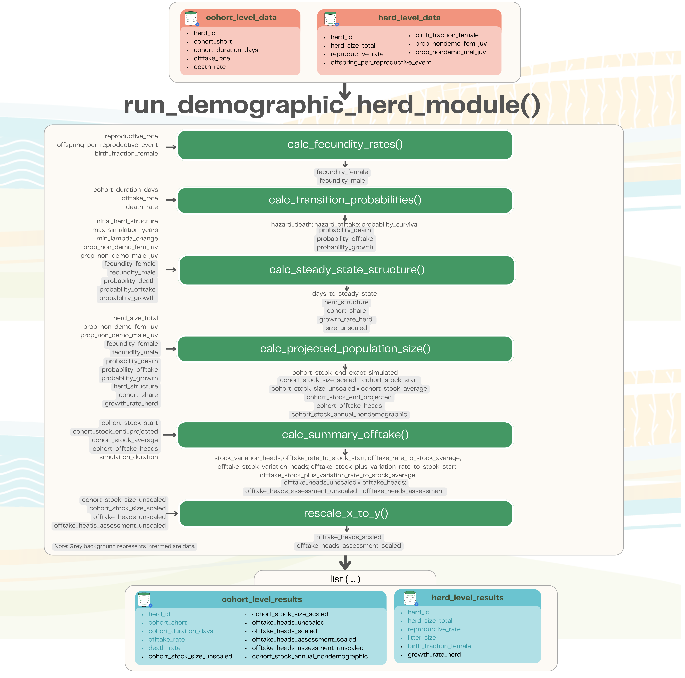

<div class="module-figure-hint"></div>

</details>

---

# Non-Demographic Herd Simulation Module

*See [`run_nondemographic_herd_module()`](../reference/run_nondemographic_herd_module.html) for full documentation.*

The non-demographic herd module calculates **average animal stock and offtake for animals managed through defined productive cycles**, rather than through the reproduction and age transitions of a breeding herd.

Unlike the demographic module, which tracks population dynamics across sex–age cohorts, this module follows animals entering a defined productive cycle. It accounts for how long animals remain in each productive phase, their mortality, and their eventual offtake.

The module considers two cohorts:

- `FN`: non-demographic female animals.
- `MN`: non-demographic male animals.

The simulation starts with the **annual number of animals entering each non-demographic cohort**, specified through:

- `cohort_stock_fem_annual_nondemo`
- `cohort_stock_mal_annual_nondemo`

These inputs can either be provided directly in `herd_level_data` when running the non-demographic module independently, or calculated from juvenile transfers by `run_all_herd_module()` when both modules are used together.

Each non-demographic cohort follows a productive cycle consisting of:

1. **Phase 1 (required):** Animals enter the first productive phase and remain there for the specified duration.
2. **Phase 2 (optional):** Animals surviving phase 1 move into a second productive phase, if one is defined.

The phases are identified using `nondemo_productive_phase_id`. Offtake is assigned to the final productive phase, and `death_rate` represents the mortality fraction over the full duration of a productive phase.

The module can also account for a rest period between productive cycles, specified through `rest_between_nondemo_cycles_duration`.

## Productive phase durations

When phase durations are supplied in `herd_level_data`, `cohort_duration_days` is not required for `FN` and `MN`. The module fills it from the herd values, which overwrite any supplied cohort values with a warning. Missing herd values fall back to the cohort values. Phase 1 must last at least 1 day; phase 2 and the rest period may be `0`.

Annual stock and offtake include animals that entered before the assessment year. Full productive phases are used even when they extend beyond 365 days. `simulation_duration` scales annual offtake to the reporting period.

## Main outputs

The module returns two datasets:

**`cohort_level_results`** includes:

- `cohort_stock_size_unscaled`: average animal stock before final herd-size scaling.
- `offtake_heads_unscaled`: annual offtake before scaling.
- `offtake_heads_assessment_unscaled`: offtake over the assessment period before scaling.
- Productive phase identifiers, effective durations, and cycle-related information.

**`herd_level_results`** includes the calculated total productive duration for each non-demographic cohort:

- `total_nondemo_fem_duration_days`
- `total_nondemo_mal_duration_days`

These durations exclude rest periods between productive cycles.

Final scaling to a supplied `herd_size_total` is handled by `run_all_herd_module()`. In a mixed run, the non-demographic results are combined with the demographic results before scaling. In a non-demographic-only run, the herd-size target is optional; without it, stock and offtake remain unscaled.

<details open>
<summary><strong>Overview of the non-demographic herd module: functions, inputs, and outputs</strong></summary>

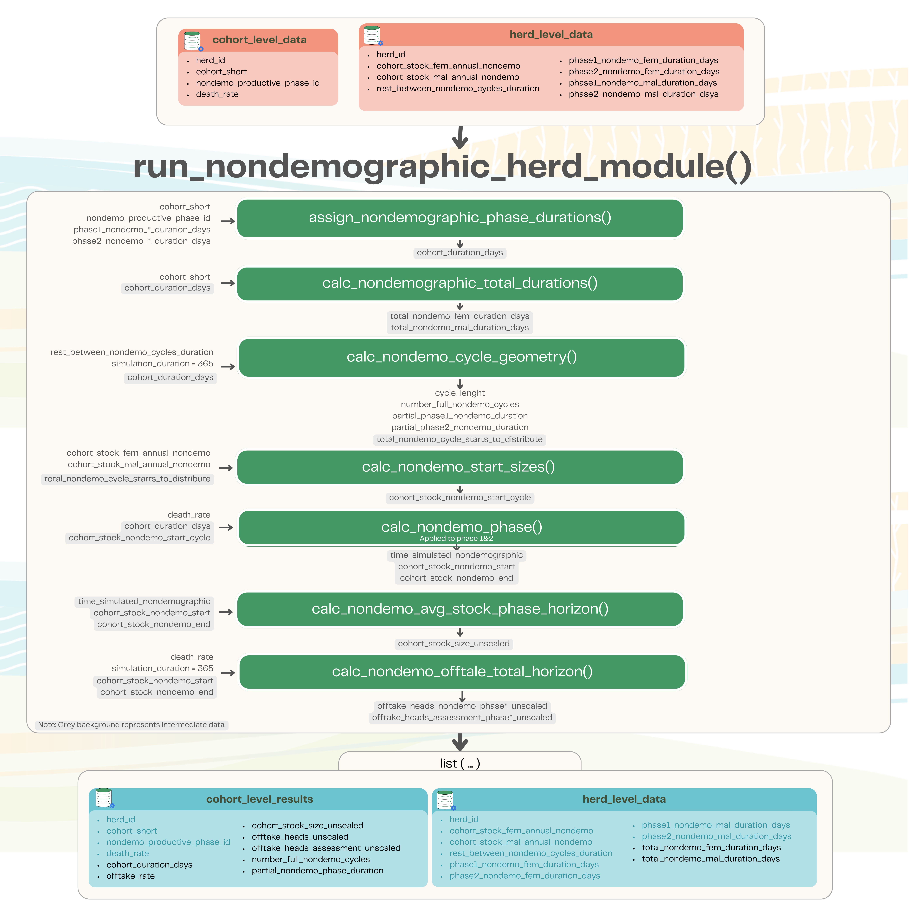

<div class="module-figure-hint"></div>

</details>

---

<span id="combined-herd-simulation-module"></span>

# Combined Herd Simulation Module {#all-herd-simulation-module}

*See [`run_all_herd_module()`](../reference/run_all_herd_module.html) for full documentation.*

The combined herd module integrates the demographic and non-demographic simulations to estimate **cohort population sizes and offtake across different livestock production systems**.

Depending on the characteristics of the production system, the herd may be represented using demographic cohorts, non-demographic cohorts, or a combination of both.

| Mode | `run_demographic` | `run_nondemographic` |
|------|-------------------|----------------------|
| Demographic only | `TRUE` | `FALSE` |
| Non-demographic only | `FALSE` | `TRUE` |
| Mixed demographic and non-demographic | `TRUE` | `TRUE` |

At least one switch must be `TRUE`.

The module coordinates the two simulation pathways:

- **Demographic pathway:** Estimates a stable sex–age herd structure, population growth, and offtake based on reproduction, mortality, and age transitions.
- **Non-demographic pathway:** Estimates average stock and offtake for animals managed through defined productive phases, based on annual entrants, phase durations, and mortality.

When both pathways are included, juvenile transfers calculated by the demographic module are passed to the non-demographic module as annual entrants. The resulting cohort populations and offtake are then combined and, when a total herd size is supplied, scaled to that herd size.

This provides a consistent representation of the animal population across both pathways for subsequent GLEAM calculations.

## Practical application

> 💡 **Practical use cases: Herd simulation across livestock production systems**
>
> *The combination of demographic and non-demographic pathways depends on how animals are managed within the livestock production system, rather than on the livestock species alone. For example:*
>
> - ***Demographic only – Beef cow–calf system:*** *A breeding herd may be represented using the six demographic cohorts (`FJ`, `FS`, `FA`, `MJ`, `MS`, `MA`), covering calves, replacement heifers, breeding cows, and bulls. Reproduction, mortality, age transitions, and offtake determine the stable herd structure.*
>
> - ***Non-demographic only – Broiler production:*** *Female (`FN`) and male (`MN`) chickens may be represented through defined productive phases, from chick placement to slaughter, without explicitly modelling reproduction or demographic age transitions. Annual animal entries, productive phase durations, and mortality determine average stock and offtake.*
>
> - ***Non-demographic only – Commercial laying hens:*** *Laying hens may be represented using the female non-demographic cohort (`FN`), with phase 1 corresponding to pullet rearing and phase 2 to the egg-laying period. Annual entries, phase durations, and mortality determine average stock, while offtake represents hens removed at the end of their productive cycle.*
>
> - ***Both pathways – Specialized dairy system with calf fattening:*** *The dairy breeding herd and replacement animals may be represented by demographic cohorts, while selected calves transferred to specialized fattening facilities may be represented by non-demographic cohorts. The demographic module estimates the juvenile flows entering the fattening pathway, and the non-demographic module calculates stock and offtake during the productive cycle.*
>
> *These examples illustrate possible configurations rather than fixed classifications. The same livestock species may be represented using either pathway or both, depending on the production system and available data.*

The following examples use dedicated cohort- and herd-level CSV files for each execution mode. Load `gleam` before running them; no filtering or column selection is needed.

```{r herd-use-cases-setup}
library(gleam)
```

### Use case 1: Run both demographic and non-demographic modules

This example runs both modules for all 15 herds. Juvenile transfers from the demographic simulation supply the annual entrants to the non-demographic phases; the combined results are rescaled to `herd_size_total`.

```{r herd-use-case-mixed}
# Load herd simulation inputs (cohort and herd-level)
herd_all_chrt_dt <- data.table::fread(system.file(
  "extdata/run_modules_examples/herd_all_input_chrt_data.csv",
  package = "gleam"
))
herd_all_hrd_dt <- data.table::fread(system.file(
  "extdata/run_modules_examples/herd_all_input_hrd_data.csv",
  package = "gleam"
))

# Run mixed demographic and non-demographic herd simulation
results <- run_all_herd_module(
  cohort_level_data = herd_all_chrt_dt,
  herd_level_data = herd_all_hrd_dt,
  run_demographic = TRUE,
  run_nondemographic = TRUE,
  simulation_duration = 365,
  show_indicator = TRUE
)
```

### Use case 2: Run the non-demographic module only

This example contains only `FN` and `MN` cohorts for CHK herds 14 and 15 (layers and broilers). Annual entrants are supplied directly. The herd file has no `herd_size_total`, so stock and offtake remain unscaled.

```{r herd-use-case-nondemographic}
# Load non-demographic-only herd inputs (CHK layers and broilers)
herd_all_chrt_dt <- data.table::fread(system.file(
  "extdata/run_modules_examples/herd_all_nondemo_input_chrt_data.csv",
  package = "gleam"
))
herd_all_hrd_dt <- data.table::fread(system.file(
  "extdata/run_modules_examples/herd_all_nondemo_input_hrd_data.csv",
  package = "gleam"
))

# Run non-demographic-only herd simulation
results <- run_all_herd_module(
  cohort_level_data = herd_all_chrt_dt,
  herd_level_data = herd_all_hrd_dt,
  run_demographic = FALSE,
  run_nondemographic = TRUE,
  simulation_duration = 365,
  show_indicator = TRUE
)
```

### Use case 3: Run the demographic module only

This example runs only the six demographic cohorts for all 15 herds. The dedicated herd file sets both juvenile-diversion proportions to `0`.

```{r herd-use-case-demographic}
# Load demographic-only herd inputs (cohort and herd-level)
herd_all_chrt_dt <- data.table::fread(system.file(
  "extdata/run_modules_examples/herd_all_demo_input_chrt_data.csv",
  package = "gleam"
))
herd_all_hrd_dt <- data.table::fread(system.file(
  "extdata/run_modules_examples/herd_all_demo_input_hrd_data.csv",
  package = "gleam"
))

# Run demographic-only herd simulation
results <- run_all_herd_module(
  cohort_level_data = herd_all_chrt_dt,
  herd_level_data = herd_all_hrd_dt,
  run_demographic = TRUE,
  run_nondemographic = FALSE,
  simulation_duration = 365,
  show_indicator = TRUE
)
```

## Combining and scaling herd populations

For mixed runs, the combined module rescales the average demographic and non-demographic stock within each `herd_id` to `herd_size_total`. The same scaling factor is applied to annual offtake and offtake over the assessment period.

Demographic-only runs use the demographic module's scaled results on a starting-stock basis. `herd_size_total` is required whenever the demographic module is enabled.

For non-demographic-only simulations, annual entrants can be provided directly. These represent the number of animals entering the production system each year and should not be confused with the average number of animals present in the herd.

If `herd_size_total` is not supplied for a non-demographic-only run, stock and offtake remain unscaled.

## Main outputs

The combined module returns cohort- and herd-level results integrating the two simulation pathways.

**`cohort_level_results`** contains:

- `cohort_stock_size`: final cohort population sizes, including demographic and non-demographic cohorts where applicable.
- `offtake_heads`: final annual offtake.
- `offtake_heads_assessment`: final offtake over `simulation_duration`.
- Juvenile transfers to the non-demographic pathway, where applicable.
- Cohort and productive phase information required by subsequent modules.

The wrapper removes the intermediate `_unscaled` and `_scaled` columns and returns stock and offtake under these common names.

**`herd_level_results`** contains the herd-level inputs and calculated indicators, including `growth_rate_herd` when demographic simulation is run, and annual non-demographic entrants and total productive-phase durations where applicable.

These outputs provide the animal population structure and offtake information required for subsequent calculations of live weights, energy requirements, feed intake, emissions, and livestock production in GLEAM.

`run_gleam()` uses this wrapper when `has_herd_structure = FALSE`. With a supplied herd structure, both herd simulations are skipped and the pipeline proceeds directly to weights.

<details open>
<summary><strong>Overview of the GLEAM combined herd module with execution modes, input and output:</strong></summary>

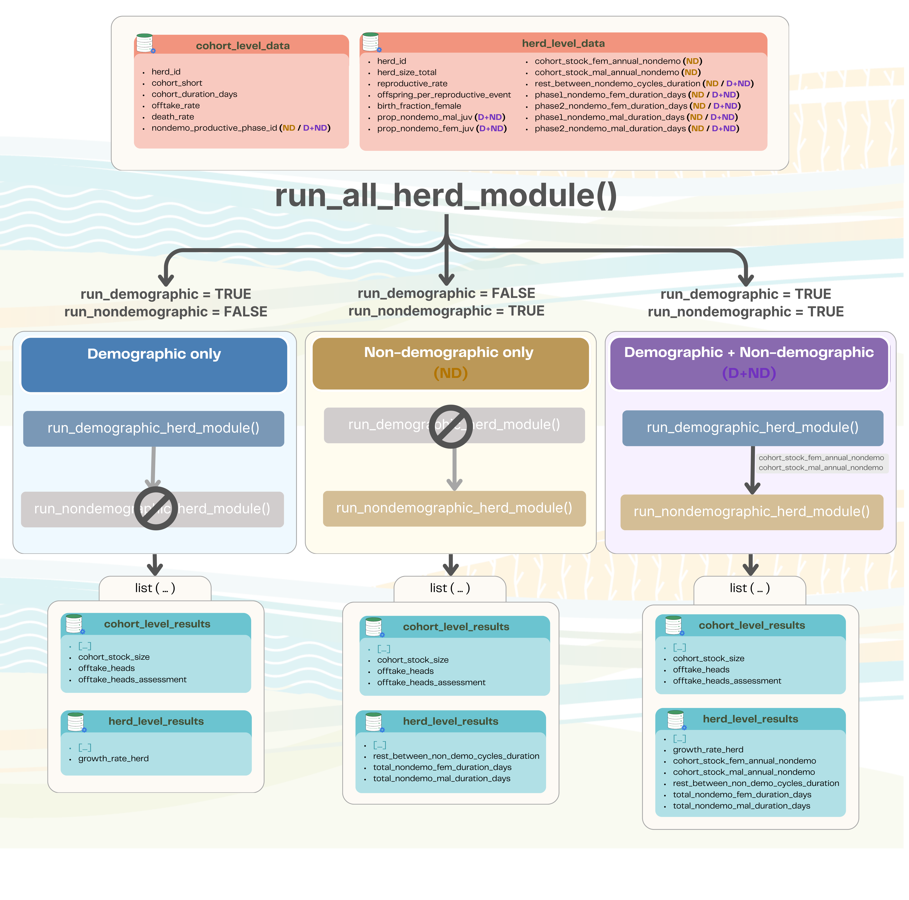
<div class="module-figure-hint"></div>

</details>

# Weights Module

*See [`run_weights_module()`](../reference/run_weights_module.html) for full documentation.*

Computes cohort-level live weight metrics by combining cohort-level inputs with
herd-level biological parameters. The module appends cohort weights (initial,
potential final, slaughter), then derives average and final live weights
accounting for offtake, and finally computes average daily live weight gain
over each cohort stage.

<details open>
<summary><strong>Overview of the GLEAM weights module with functions, input and output:</strong></summary>

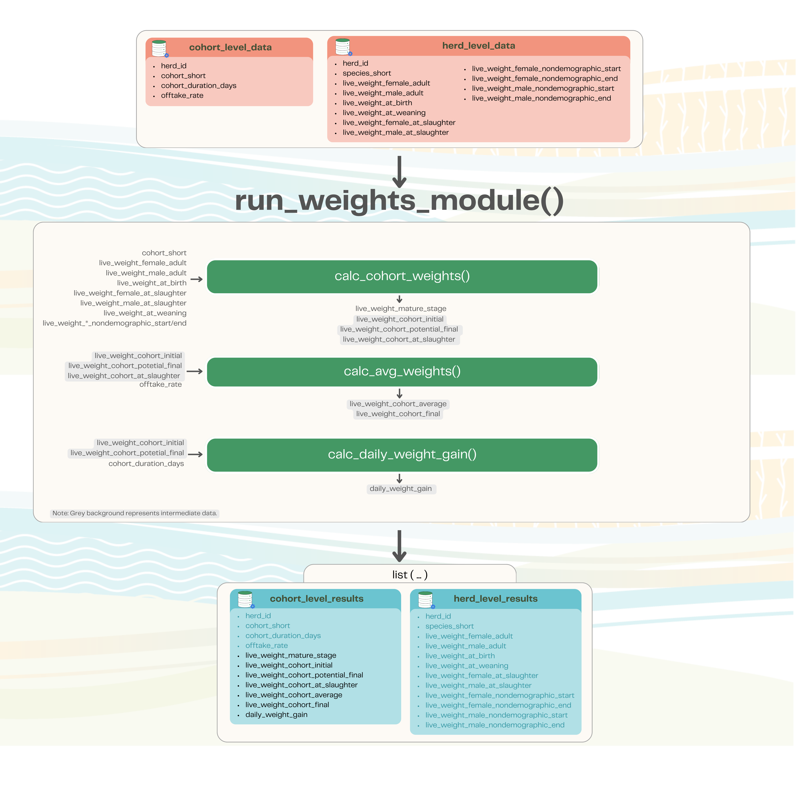
<div class="module-figure-hint"></div>

</details>

The calculation pipeline consists of the following steps:

1. **Cohort-stage weight assignment** — herd-level biological parameters are
   matched to each cohort row by `herd_id` and weights are assigned per life
   stage using [`calc_cohort_weights()`](../reference/calc_cohort_weights.html).
2. **Average and final live weights (accounting for offtake)** — computed using
    [`calc_avg_weights()`](../reference/calc_avg_weights.html).
3. **Average daily live weight gain** — computed using
    [`calc_daily_weight_gain()`](../reference/calc_daily_weight_gain.html).


# Ration Nutritional Content Module

*See [`run_ration_quality_module()`](../reference/run_ration_quality_module.html) for full documentation.*

Computes cohort-level diet nutritional metrics — gross and metabolizable energy
content, digestibility, nitrogen content, urinary energy losses, and ash
content — from cohort-level feed ration composition shares and feed component
nutrient parameters.

<details open>
<summary><strong>Overview of the GLEAM ration nutritional content module with functions, input and output:</strong></summary>

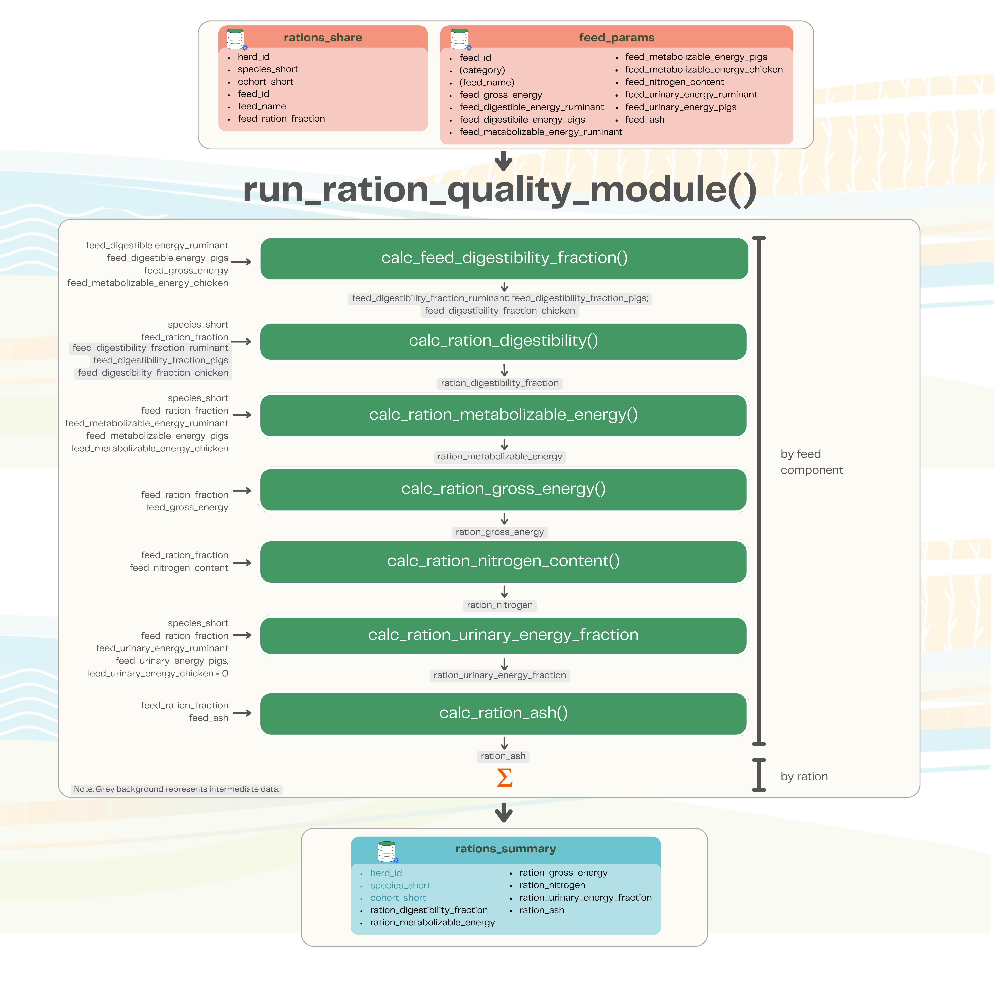
<div class="module-figure-hint"></div>

</details>

The module joins ration shares with feed parameters by `feed_id`, uses
`species_short` for species-specific lookups, and computes ration-weighted
nutritional metrics by cohort through the following steps:

1. Species-specific digestibility fractions are computed from energy parameters
   using [`calc_feed_digestibility_fraction()`](../reference/calc_feed_digestibility_fraction.html).
2. Contributions of each feed component are computed as ration-weighted values for:
   - gross energy — [`calc_ration_gross_energy()`](../reference/calc_ration_gross_energy.html)
   - nitrogen — [`calc_ration_nitrogen_content()`](../reference/calc_ration_nitrogen_content.html)
   - digestibility — [`calc_ration_digestibility()`](../reference/calc_ration_digestibility.html)
   - metabolizable energy — [`calc_ration_metabolizable_energy()`](../reference/calc_ration_metabolizable_energy.html)
   - urinary energy fraction — [`calc_ration_urinary_energy_fraction()`](../reference/calc_ration_urinary_energy_fraction.html)
   - ash — [`calc_ration_ash()`](../reference/calc_ration_ash.html)
3. Component contributions are summed to produce cohort-level diet metrics,
   grouped by `herd_id`, `species_short`, and `cohort_short`, and by
   `nondemo_productive_phase_id` when supplied in `rations_share`.

The returned `data.table` contains `ration_gross_energy` and
`ration_metabolizable_energy` (MJ/kg DM), `ration_nitrogen` (kg N/kg DM),
`ration_digestibility_fraction`, `ration_urinary_energy_fraction`, and
`ration_ash` (kg ash/kg DM). Ration intake is calculated in the energy
requirements module using these diet characteristics.


# Metabolic Energy Requirements and Ration Intake Module

*See [`run_metabolic_energy_req_module()`](../reference/run_metabolic_energy_req_module.html) for full documentation.*

Computes cohort-level daily energy requirements (MJ/head/day) and feed dry
matter intake (kg DM/head/day) by applying the IPCC Tier 2 energy partitioning
functions.

Energy requirements are expressed as **net energy (NE)** for CTL, BFL, SHP,
and GTS, and as **metabolizable energy (ME)** for CML, PGS, and CHK. The
module computes the following energy partitions:

- Maintenance — [`calc_metabolic_energy_req_maintenance()`](../reference/calc_metabolic_energy_req_maintenance.html)
- Activity — [`calc_metabolic_energy_req_activity()`](../reference/calc_metabolic_energy_req_activity.html)
- Growth — [`calc_metabolic_energy_req_growth()`](../reference/calc_metabolic_energy_req_growth.html)
- Lactation — [`calc_metabolic_energy_req_lactation()`](../reference/calc_metabolic_energy_req_lactation.html)
- Pregnancy — [`calc_metabolic_energy_req_pregnancy()`](../reference/calc_metabolic_energy_req_pregnancy.html)
- Work (draught power; CTL, BFL, CML only) — [`calc_metabolic_energy_req_work()`](../reference/calc_metabolic_energy_req_work.html)
- Fibre production (SHP, GTS, CML only) — [`calc_metabolic_energy_req_fibre()`](../reference/calc_metabolic_energy_req_fibre.html)
- Egg deposition (CHK only) — [`calc_metabolic_energy_req_eggs()`](../reference/calc_metabolic_energy_req_eggs.html)

For chickens (`CHK`), the model distinguishes between **reproductive eggs**
(used for breeding) and **food eggs** (produced for human consumption).

- **Reproductive eggs:** Egg production energy requirements are always
  calculated for adult females (`FA`), based on `reproductive_rate`.
- **Food eggs:** Energy requirements for food-egg production are calculated
  only when `is_egg_producing = TRUE`. This option is available for adult
  females (`FA`) and non-demographic females (`FN`) in productive phase 2.
  Annual food-egg production per hen is specified by
  `egg_human_consumption_yield` (eggs/hen/year).

Total energy requirements are then aggregated using
[`calc_total_metabolic_energy_req()`](../reference/calc_total_metabolic_energy_req.html),
and dry matter intake is derived using
[`calc_ration_intake()`](../reference/calc_ration_intake.html) by dividing the
total energy requirement by the diet energy density.

<details open>
<summary><strong>Overview of the GLEAM metabolic energy requirements module with functions, input and output:</strong></summary>

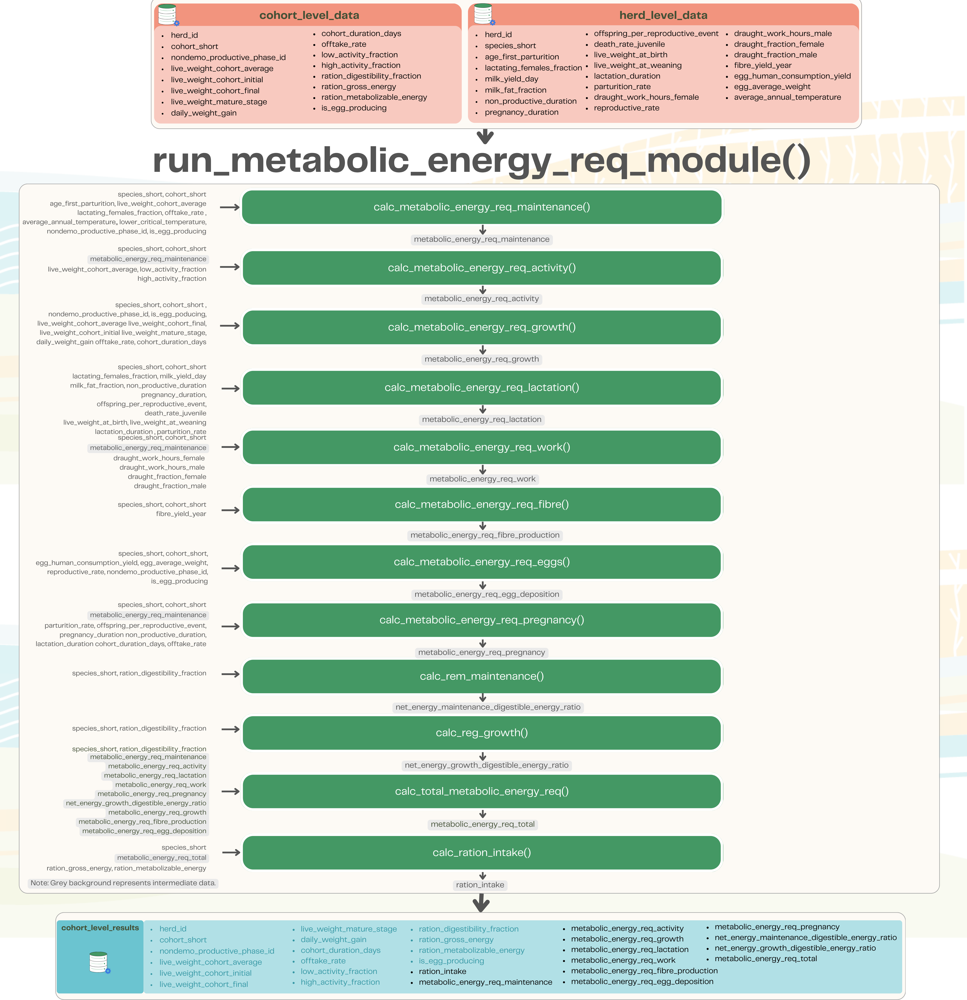
<div class="module-figure-hint"></div>

</details>


# Enteric Emissions Module

*See [`run_emissions_enteric_module()`](../reference/run_emissions_enteric_module.html) for full documentation.*

Computes daily enteric methane emissions by cohort (kg CH₄/head/day) using the
IPCC Tier 2 approach, by applying species-, cohort-, and diet-specific methane
conversion factors (ym).
<details open>
<summary><strong>Overview of the GLEAM enteric emissions module with functions, input and output:</strong></summary>

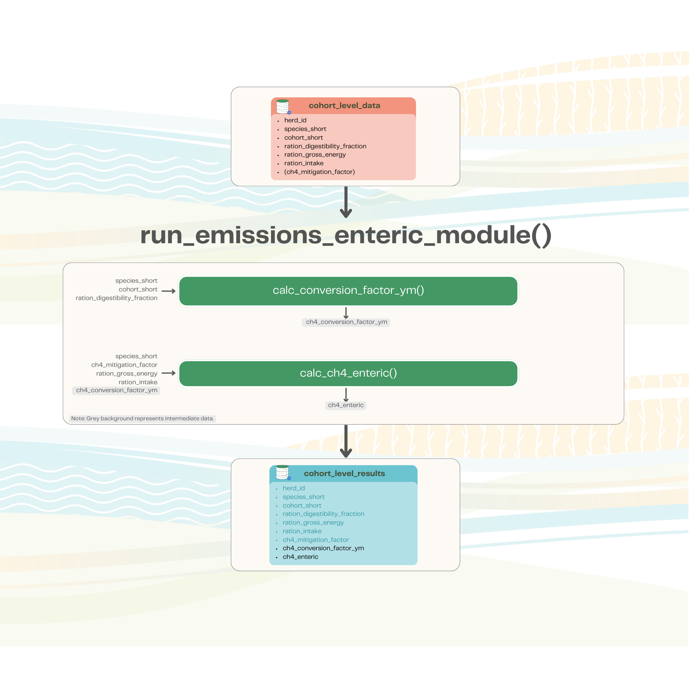
<div class="module-figure-hint"></div>

</details>

The calculation pipeline consists of the following steps:

1. If `ch4_mitigation_factor` is not provided in the input data, it is set to
   `1` (no mitigation).
2. The methane conversion factor (ym) is computed using
    [`calc_conversion_factor_ym()`](../reference/calc_conversion_factor_ym.html).
3. Daily enteric methane emissions are computed using
    [`calc_ch4_enteric()`](../reference/calc_ch4_enteric.html).


# Nitrogen Balance Module

*See [`run_nitrogen_balance_module()`](../reference/run_nitrogen_balance_module.html) for full documentation.*

Computes cohort-level daily nitrogen intake, retention, and excretion
(kg N/head/day) following the IPCC Tier 2 approach.

<details open>
<summary><strong>Overview of the GLEAM nitrogen balance module with functions, input and output:</strong></summary>

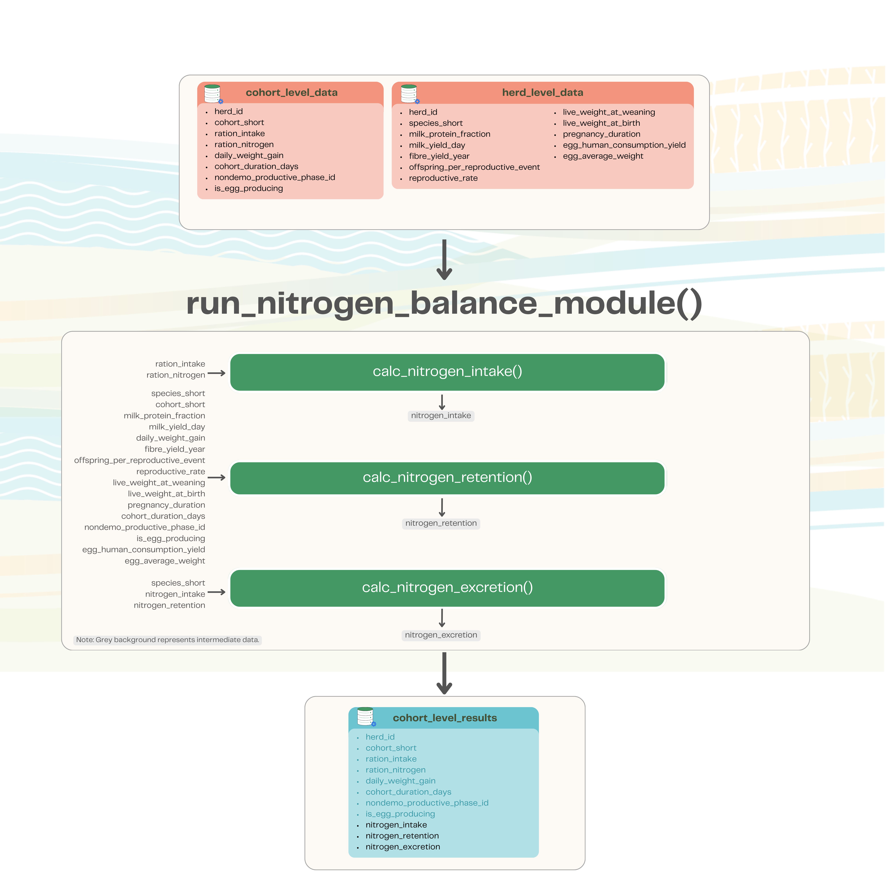
<div class="module-figure-hint"></div>

</details>

The following calculation sequence is applied:

1. Daily nitrogen intake is computed from `ration_intake` and `ration_nitrogen`
   using [`calc_nitrogen_intake()`](../reference/calc_nitrogen_intake.html).
2. Daily nitrogen retention (in body tissues and products such as growth,
   pregnancy, milk, and eggs) is computed using
    [`calc_nitrogen_retention()`](../reference/calc_nitrogen_retention.html).
3. Daily nitrogen excretion is computed as intake minus retention using
    [`calc_nitrogen_excretion()`](../reference/calc_nitrogen_excretion.html).

The module appends `nitrogen_intake`, `nitrogen_retention`, and
`nitrogen_excretion` to the cohort table (kg N/head/day), preserving supplied
phase identifiers for downstream manure calculations.


# Manure Emissions Module

*See [`run_emissions_manure_module()`](../reference/run_emissions_manure_module.html) for full documentation.*

Computes cohort-level greenhouse gas emissions from manure management systems
(MMS) following the IPCC Tier 2 methodology, using volatile solids (VS), MMS
allocation fractions, and MMS-specific emission factors.


<details open>
<summary><strong>Overview of the GLEAM manure emissions module with functions, input and output:</strong></summary>

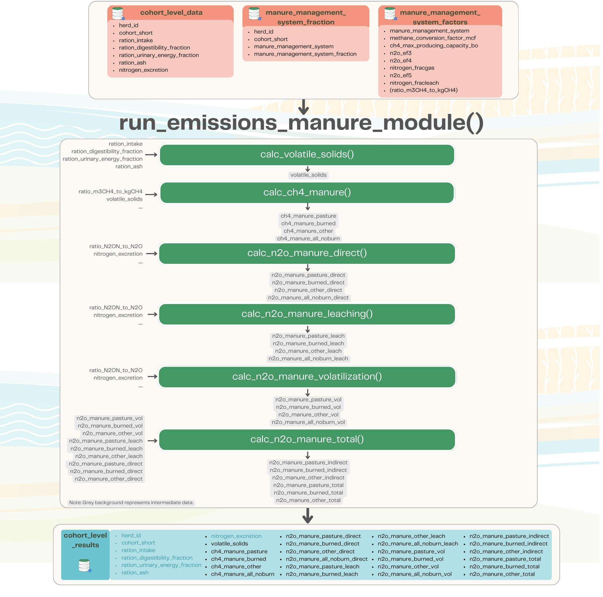
<div class="module-figure-hint"></div>

</details>

For each `herd_id`, the set of MMS identifiers must be consistent between the
`manure_management_system_fraction` and `manure_management_system_factors`
tables.

`nondemo_productive_phase_id` is optional in the manure fraction table. If
omitted or entirely `NA`, fractions are matched by `herd_id` and `cohort_short`
and reused for each phase of that cohort. If the fractions specify phases,
the cohort table must also contain the phase identifier, and matching includes
`nondemo_productive_phase_id`. Input cohort rows and phase identifiers are
preserved in the results.

The following calculation sequence is applied:

1. **Volatile solids (VS)** excretion is computed from feed ration nutritional
   parameters (digestibility, urinary energy, ash) using
   [`calc_volatile_solids()`](../reference/calc_volatile_solids.html)
   (IPCC 2006/2019, Eq. 10.24).
2. **Methane (CH₄)** emissions from manure management are computed from VS and
   MMS-specific factors (MCF and B₀), reported by MMS group (pasture, burned,
   other) using [`calc_ch4_manure()`](../reference/calc_ch4_manure.html)
   (IPCC 2006/2019, Eq. 10.23).
3. **Direct N₂O** emissions are computed from nitrogen excretion and
    MMS-specific EF3 values, reported by MMS group using
    [`calc_n2o_manure_direct()`](../reference/calc_n2o_manure_direct.html)
    (IPCC 2006/2019, Eq. 10.25).
4. **Indirect N₂O** emissions are the sum of:
   - Volatilisation-driven N₂O from MMS-specific nitrogen losses (FracGas) and
     EF4 using [`calc_n2o_manure_volatilization()`](../reference/calc_n2o_manure_volatilization.html)
        (IPCC 2006/2019, Eq. 10.26–10.28).
   - Leaching/runoff-driven N₂O from MMS-specific nitrogen losses (FracLeach)
     and EF5 using [`calc_n2o_manure_leaching()`](../reference/calc_n2o_manure_leaching.html)
        (IPCC 2006/2019, Eq. 10.27–10.29).
5. **Total N₂O** (direct + indirect) is summed by MMS group using
    [`calc_n2o_manure_total()`](../reference/calc_n2o_manure_total.html).

The returned cohort table contains `volatile_solids` and the methane and
nitrous oxide emission columns for pasture, burned, and other MMS groups.
Emission values are expressed in kg gas/head/day; herd totals over the
assessment period are calculated by the aggregation module.


# Feed Production Emissions Module

*See [`run_emissions_ration_module()`](../reference/run_emissions_ration_module.html) for full documentation.*

Computes cohort-level average greenhouse gas emission factors from feed
production by weighting the emission factors of individual feed components by
diet composition. Returns diet-level average GHG emission factors by gas and
emission source for each cohort.

The module joins ration shares with feed emission factors by `feed_id` and
applies the following calculation sequence:

1. **Merge** ration shares with emission factors at the feed-component level.
2. **Compute feed-component contributions** (row-wise) for each emission source
   by multiplying the ration share of each feed component
   (`feed_ration_fraction`) by the corresponding emission factor:
   - CO₂ from fertilizer manufacture — [`calc_co2_ration_fertilizer()`](../reference/calc_co2_ration_fertilizer.html)
   - CO₂ from pesticide manufacture — [`calc_co2_ration_pesticides()`](../reference/calc_co2_ration_pesticides.html)
   - CO₂ from on-field crop activities — [`calc_co2_ration_crop_activities()`](../reference/calc_co2_ration_crop_activities.html)
   - CO₂ from land-use change (no peat) — [`calc_co2_ration_luc_nopeat()`](../reference/calc_co2_ration_luc_nopeat.html)
   - CO₂ from land-use change (peat) — [`calc_co2_ration_luc_peat()`](../reference/calc_co2_ration_luc_peat.html)
   - N₂O from fertilizer use — [`calc_n2o_ration_fertilizer()`](../reference/calc_n2o_ration_fertilizer.html)
   - N₂O from manure applied to soil — [`calc_n2o_ration_manure()`](../reference/calc_n2o_ration_manure.html)
   - N₂O from crop residues — [`calc_n2o_ration_crop_residues()`](../reference/calc_n2o_ration_crop_residues.html)
   - CH₄ from rice cultivation — [`calc_ch4_ration_rice()`](../reference/calc_ch4_ration_rice.html)
3. **Sum** component contributions within each cohort to obtain diet-level
   average emission factors (g gas/kg DM).


<details open>
<summary><strong>Overview of the GLEAM feed production emissions module with functions, input and output:</strong></summary>

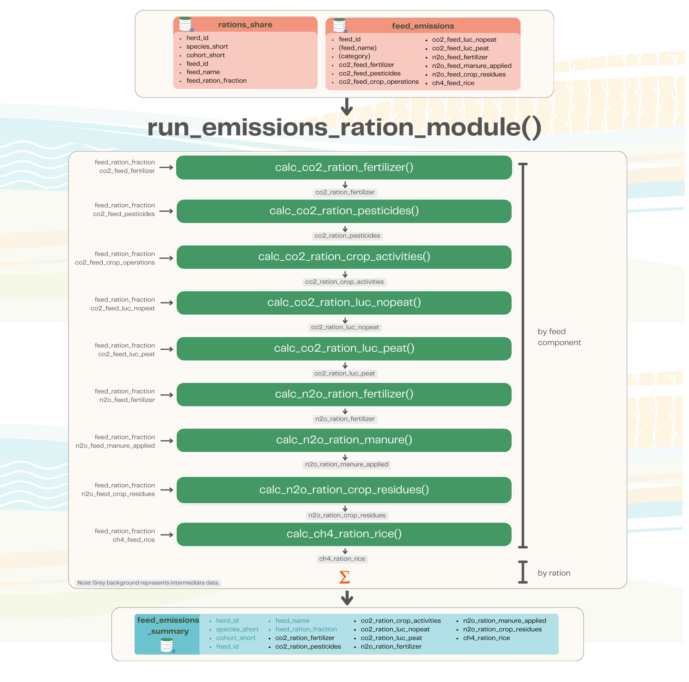
<div class="module-figure-hint"></div>

</details>

# Production Module

*See [`run_production_module()`](../reference/run_production_module.html) for full documentation.*

Computes cohort-level production outputs over the assessment period by
combining cohort-level herd structure inputs with herd-level production
parameters. The module returns milk, fibre, meat, and food-egg outputs for each
cohort.

<details open>
<summary><strong>Overview of the GLEAM production module with functions, input and output:</strong></summary>

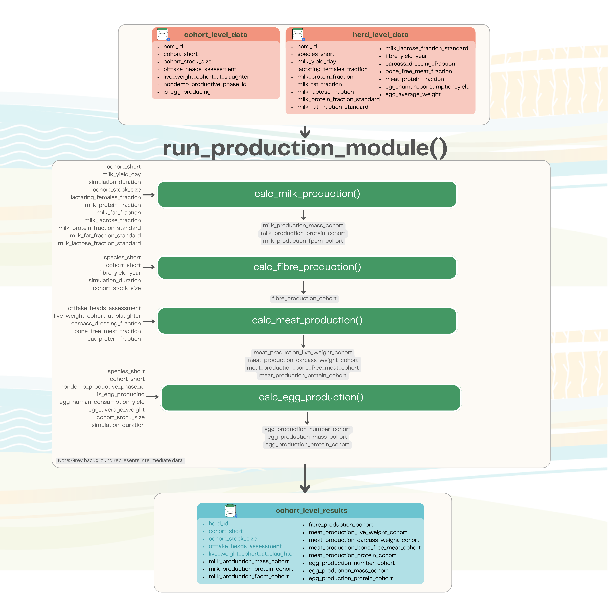
<div class="module-figure-hint"></div>

</details>

The following calculation sequence is applied:

1. Milk outputs (raw mass, protein, and fat-protein-corrected milk — FPCM) are
   computed using [`calc_milk_production()`](../reference/calc_milk_production.html).
2. Fibre outputs (wool, cashmere, mohair) are computed using
    [`calc_fibre_production()`](../reference/calc_fibre_production.html).
3. Meat outputs (live weight, carcass weight, bone-free meat, and protein) are
   computed from `offtake_heads_assessment` and slaughter weight using
   [`calc_meat_production()`](../reference/calc_meat_production.html).
4. Food-egg outputs (number, mass, and protein) are computed using
   [`calc_egg_production()`](../reference/calc_egg_production.html).

For chickens (`CHK`), the model distinguishes between **food eggs** (produced
for human consumption) and **reproductive eggs** (used for breeding).

Food-egg production is calculated only when `is_egg_producing = TRUE`, which
is supported for adult females (`FA`) and non-demographic females (`FN`) in
productive phase 2.

# Emission Allocation Module

*See [`run_allocation_module()`](../reference/run_allocation_module.html) for full documentation.*

Computes biophysical allocation shares for livestock commodities by calculating
cohort-level energy requirements for meat, milk, fibre, work, and eggs,
aggregating these terms to herd level, and assigning allocation shares to
emission sources.
The approach follows the IDF Global Carbon Footprint Standard for the dairy
sector, adapted for livestock systems in which emissions are apportioned among
multiple products according to their physiological energy requirements. This is
consistent with ISO 14044:2006 (Section 4.3.4.2, Step 2).
<details open>
<summary><strong>Overview of the GLEAM emissions allocation module with functions, input and output:</strong></summary>

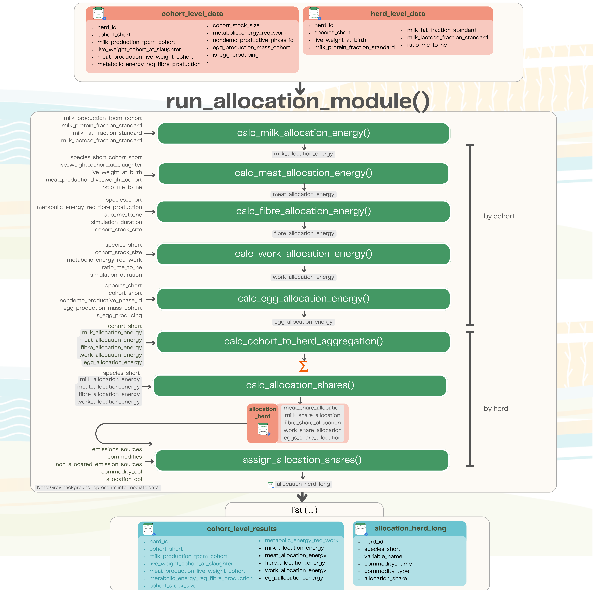
<div class="module-figure-hint"></div>

</details>


The pipeline consists of the following steps:

1. **Cohort-level energy allocation terms** are computed for each commodity:
   - Meat — [`calc_meat_allocation_energy()`](../reference/calc_meat_allocation_energy.html)
   - Milk — [`calc_milk_allocation_energy()`](../reference/calc_milk_allocation_energy.html)
   - Fibre — [`calc_fibre_allocation_energy()`](../reference/calc_fibre_allocation_energy.html)
   - Work (draught power) — [`calc_work_allocation_energy()`](../reference/calc_work_allocation_energy.html)
   - Eggs — [`calc_egg_allocation_energy()`](../reference/calc_egg_allocation_energy.html)
2. **All five cohort-level energy terms, including `egg_allocation_energy`,
   are aggregated to herd level** using
   [`calc_cohort_to_herd_aggregation()`](../reference/calc_cohort_to_herd_aggregation.html).
3. **Herd-level allocation shares** are computed using
    [`calc_allocation_shares()`](../reference/calc_allocation_shares.html),
    including `eggs_share_allocation`.
4. **Allocation shares are reshaped to long format** and assigned to emission
   sources using [`assign_allocation_shares()`](../reference/assign_allocation_shares.html).


# Aggregation and Reporting Module

*See [`run_aggregation_module()`](../reference/run_aggregation_module.html) for full documentation.*

This is the final step of the GLEAM pipeline. It generates final herd-level
results by aggregating key cohort-level outputs, scaling variables over the
assessment duration, allocating emissions to commodities, and converting CH₄
and N₂O emissions to CO₂-equivalents (CO₂eq) using selected 100-year Global
Warming Potential (GWP-100) factors.

<details open>
<summary><strong>Overview of the GLEAM aggregation module with functions, input and output:</strong></summary>

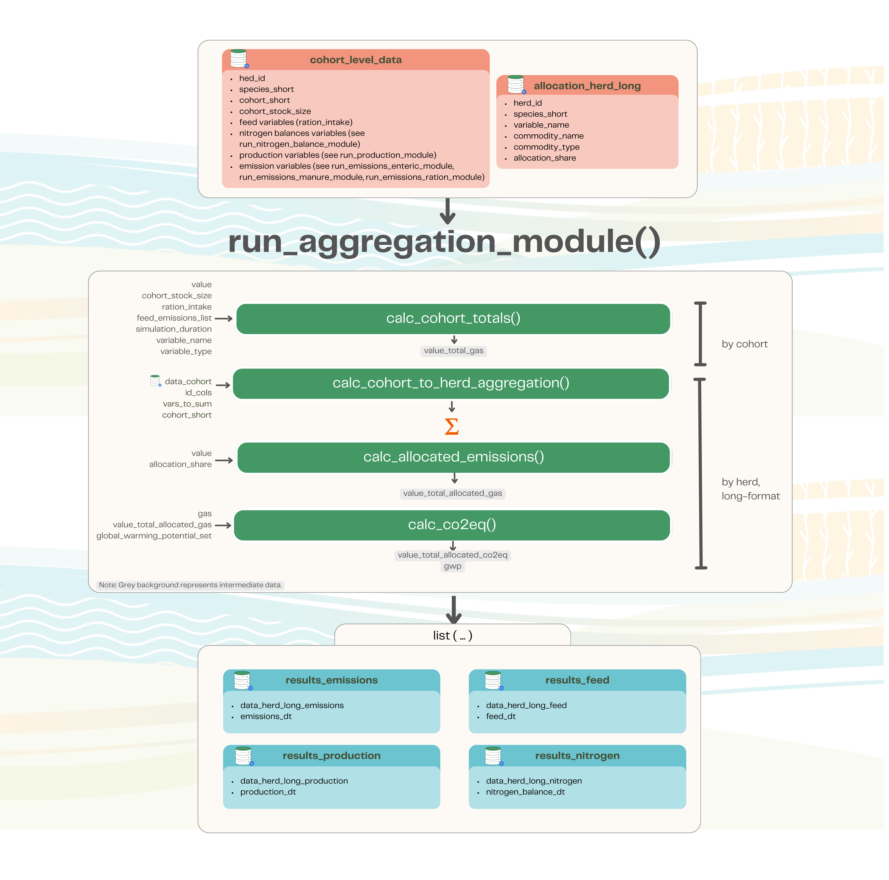
<div class="module-figure-hint"></div>

</details>

The following calculation sequence is applied:

1. Cohort-level variables are reshaped from wide to long format.
2. Variables are classified into `"Feed"`, `"NitrogenBalance"`,
    `"Production"`, and `"Emissions"`.
3. Cohort totals are calculated using
   [`calc_cohort_totals()`](../reference/calc_cohort_totals.html). Production
   variables are retained as provided because they already cover the cohort
   and assessment period. Daily per-head emissions, feed intake, and nitrogen
   balance variables are multiplied by `cohort_stock_size` and
   `simulation_duration`. Feed emission factors are additionally multiplied
   by `ration_intake` and divided by 1000 to convert grams to kilograms of gas.
4. Cohort totals are aggregated to herd level using
    [`calc_cohort_to_herd_aggregation()`](../reference/calc_cohort_to_herd_aggregation.html).
5. Herd-level emissions are merged with commodity allocation shares.
6. Emissions are allocated to commodities using
    [`calc_allocated_emissions()`](../reference/calc_allocated_emissions.html).
7. Gas type (CH₄, N₂O, CO₂) is identified from the emission variable name.
8. Allocated emissions are converted to CO₂eq using
   [`calc_co2eq()`](../reference/calc_co2eq.html) and the selected GWP-100
   option (AR4, AR5, or AR6).
9. Final output tables are produced summarising herd-level results for
    emissions, feed, production, and nitrogen balance.
